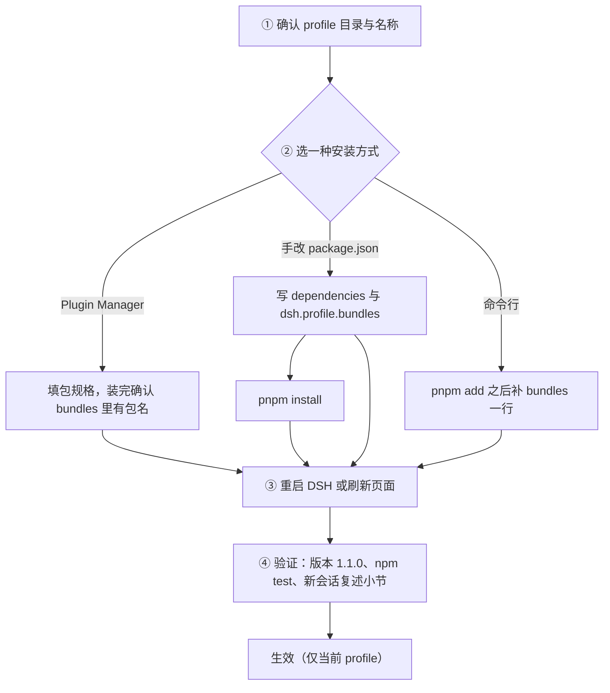

# dsh-dual-track-output

一个 [DeepSeek Harness](https://github.com/deepseek-ai/deepseek-harness) 插件包：让Agent按「双轨」作答——**文字负责结论与推理，图表负责结构、对比、流程与数据**。

它只做一件事：往系统提示词里注册一条静态段落。不含工具、不含界面、没有依赖、不联网。

## 它对模型提了什么要求

| 规则块 | 规定 |
|---|---|
| `structure` | 开头 3–5 句给结论；图表放在相关论述之后，按图1、图2…编号，正文用「（见图1）」引用；每张图后接 1–2 句读图要点；结尾给小结或下一步。 |
| `triggers` | 命中需要出图的场景后出图：多方案横向对比、流程与时间线、层级结构、带数据的趋势或占比、五条以上清单、抽象机制示意等。 |
| `charts` | 按内容选型：柱状图、折线图、饼图/环形图、散点图、流程图、框图、树状图、矩阵表、Markdown 表格等。 |
| `figure` | 图题在上，图例与坐标轴齐全，宽度自适应，数值与正文一致；没有真实数据时显式标注「示意/假设数据」，禁止编造精确数值。 |
| `layout` | 图表尺寸与图文排版硬指标：容器占满整行（并排 ≥520px）、图表高度 min(60vh, 520px) 且 ≥360px、必须 ECharts 渲染并监听尺寸变化重绘、字号与 grid 预留、标题写结论、一图一结论、间距与移动端单列；图片呈现要求按正文列宽 100% 等比例放大、`height: auto` 不裁切、按 2× 像素导出。违反即返工。 |
| `geometry` | 构图几何：同类元素只给尺寸与最小间距两个常量、位置循环累加，生成后用断言自检间距与文本宽度；连线终点由框的 x/y/w/h 反推、多路入点错开、箭头停在边框上；分组底色等第二层结构由第一层元素算出。 |
| `html` | 需要交付文件或交互时：单个自包含 HTML，内联 CSS/JS，图表用成熟库（如 CDN 引入 ECharts），一屏一图，主色不超过三种，文末附图表明细与数据口径。 |
| `fallback` | 环境无法渲染图表时，改用 Mermaid 代码块、Markdown 表格、缩进列表，并主动说明这是替代版。 |
| `redlines` | 禁止无信息增量的装饰图，禁止图表与结论矛盾，禁止堆砌无关图，禁止数据造假。 |

默认文本为中文；设置 `language: en` 可切换到结构完全相同的英文版。


## 安装

这个包只往系统提示词里注册一段文字，所以要装进 **profile**（DSH 的配置单元），而不是某个工作区。装一次，该 profile 下的所有会话、所有子代理都会看到这段契约；换工作区不受影响。



### 第 0 步：装之前确认三件事

| 检查项 | 怎么确认 | 期望值 |
|---|---|---|
| DSH 版本 | 命令面板 → 关于，或 `dsh --version` | ≥ `0.2.0-rc.1` |
| profile 目录 | 环境变量 `DSH_PROFILE_DIR`，或默认 `~/.dsh/profiles/desktop` | 目录里有 `package.json` 和 `cordis.patch.yml` |
| 当前用的 profile | 启动 DSH 时选的 profile 名 | 例如 `desktop`；装到别的 profile 不会报错，但**不会生效** |

Windows 下默认路径是 `C:\Users\<用户名>\.dsh\profiles\desktop`。

### 第 1 步：安装（三种方式任选一种）

**方式 A：Plugin Manager（最省事）**

1. 打开 DSH → **Plugin Manager** → 安装插件包。
2. 包规格填 `github:DING0101001/dsh-dual-track-output#v1.1.0`。`#v1.1.0` 是版本锁；想去掉锁定、跟随最新代码，就把 `#v1.1.0` 删掉。
3. 装完确认包名 `dsh-dual-track-output` 已出现在当前 profile 的 `dsh.profile.bundles` 里（管理器通常会自动加；没加就照方式 B 手动补一行）。

**方式 B：手改 profile 的 `package.json`**

在 `<profile>/package.json` 里加两处——依赖，以及 bundles 清单：

```json
{
  "dependencies": {
    "dsh-dual-track-output": "github:DING0101001/dsh-dual-track-output#v1.1.0"
  },
  "dsh": {
    "profile": {
      "bundles": ["dsh-dual-track-output"]
    }
  }
}
```

然后在 profile 目录里装依赖：

```bash
pnpm install
```

**方式 C：命令行**

```bash
cd ~/.dsh/profiles/desktop        # Windows: cd %USERPROFILE%\.dsh\profiles\desktop
pnpm add github:DING0101001/dsh-dual-track-output#v1.1.0
```

再把 `"dsh-dual-track-output"` 加进同目录 `package.json` 的 `dsh.profile.bundles`。

### 第 2 步：让改动生效

1. 改过 `package.json` 的，先跑 `pnpm install`；
2. 重启 DSH（或刷新页面、让 profile 重载）；
3. bundle 自带 `cordis.patch.yml`，会自动插入一行 `id: dual-track-output`、`enabled: true`——**不需要手动加行**；要改行为时，在 profile 的 `cordis.patch.yml` 里覆盖这一行（见「配置」）。

这样安装的包是**复制**进 profile 目录的（不是软链），所以与打开哪个工作区无关。

### 第 3 步：验证是否装好

四条都通过就算成功：

1. `node_modules/dsh-dual-track-output/package.json` 里 `"version": "1.1.0"`；
2. 在该目录跑 `npm test`，输出 `render-check: ok`；
3. 重启后新开会话，问它「你的系统提示词里关于输出风格的段落是什么？」——应能复述标题 `## 输出风格：文字 + 可视化双轨` 以及九个小节名（`结构与顺序`、`必须出图的场景`、…、`红线`）；
4. 若没出现，按「常见问题」逐条排查。

### 第 4 步：更新与卸载

```bash
pnpm update dsh-dual-track-output      # 更新到规格里的最新版本
```

卸载：从 `dsh.profile.bundles` 里删掉包名 → `pnpm remove dsh-dual-track-output` → 重启。只想临时关闭、保留安装，就在覆盖配置里设 `enabled: false`。

### 多个 profile 互相独立

profile 之间互不影响：你用的每个 profile（例如 `desktop` 和 `web`）都要各装一次；在 `desktop` 装好，`web` 里看不到。

### 常见问题

| 现象 | 原因 | 处理 |
|---|---|---|
| 装完没反应 | 装到了别的 profile，或包名没进 `dsh.profile.bundles` | 用 `DSH_PROFILE_DIR` 确认目录，补上 bundle 名并重启 |
| `npm test` 报错 | Node 版本过低 | 用 Node ≥ 20 |
| `pnpm add` 卡住或超时 | 访问不到 github.com | 配代理，或设置 `git config --global http.proxy` |
| 只想给某个项目用 | 本插件是 profile 级 | 给该 agent 的 preset 注册同名 `section` 覆盖（见「配置」中的 `section`） |
| 想换版本 | 规格里带了 `#v1.1.0` | 改规格里的 tag 后 `pnpm update`；不带 tag 则跟随 `main` |

## 配置

在 profile 的 `cordis.patch.yml` 里覆盖 `dual-track-output` 行。覆盖会**整体替换** `config`，所以要保留的字段必须全部重写。

```yaml
- id: dual-track-output
  name: dsh-dual-track-output
  config:
    enabled: true          # false 即不启用
    language: zh           # zh | en
    order: 9000            # 提示词顺序；官方环境事实从 10000 起
    section: output:dual-track
    append: ''             # 追加到最后一条启用块之后的额外规定
    blocks:
      structure: true
      triggers: true
      charts: true
      figure: true
      layout: true
      geometry: true
      html: true
      fallback: true
      redlines: true
```

| 字段 | 默认值 | 含义 |
|---|---|---|
| `enabled` | `true` | 设为 false 时插件不启用。 |
| `language` | `zh` | 文本包，`zh` 或 `en`。 |
| `order` | `9000` | 段落顺序。官方行为指导在 10000 以下，环境事实在 10000 以上。 |
| `section` | `output:dual-track` | 注册的段落名；同名的 scoped 段落可对单个 agent 覆盖它。 |
| `blocks.*` | `true` | 逐个开关九个规则块。 |
| `append` | `''` | 追加在末尾的额外规定。 |

## 离线自检

```bash
npm test            # 离线渲染该段落，逐块检查内容与开关行为
```

它会断言九个小节都在、`layout` / `geometry` 能单独关闭、`append` 追加在最后，并且启用时只注册一条 `interpolate: false` 的段落。装进 profile 后的在线验证见「安装 · 第 3 步」。

## 实现要点

- 只在 `ctx.effect()` 内做一次 `ctx.systemPrompt.section()` 注册；插件卸载或被禁用时，这段文字随之移除。
- 静态文本 + `interpolate: false`：提示词前缀逐字节稳定，不会破坏 KV cache 复用。
- 仅声明 `inject: ['systemPrompt']`，不读会话状态、不写文件。

## 兼容性

基于 DeepSeek Harness `0.2.x` 编写（`ctx.systemPrompt.section({ name, order, text, interpolate })`），依赖 `system-prompt` 包，标准 profile 均自带。

## 卸载

删掉该行（或设 `enabled: false`），从 `dsh.profile.bundles` 里去掉包名，再移除依赖即可。

## 许可

MIT。
